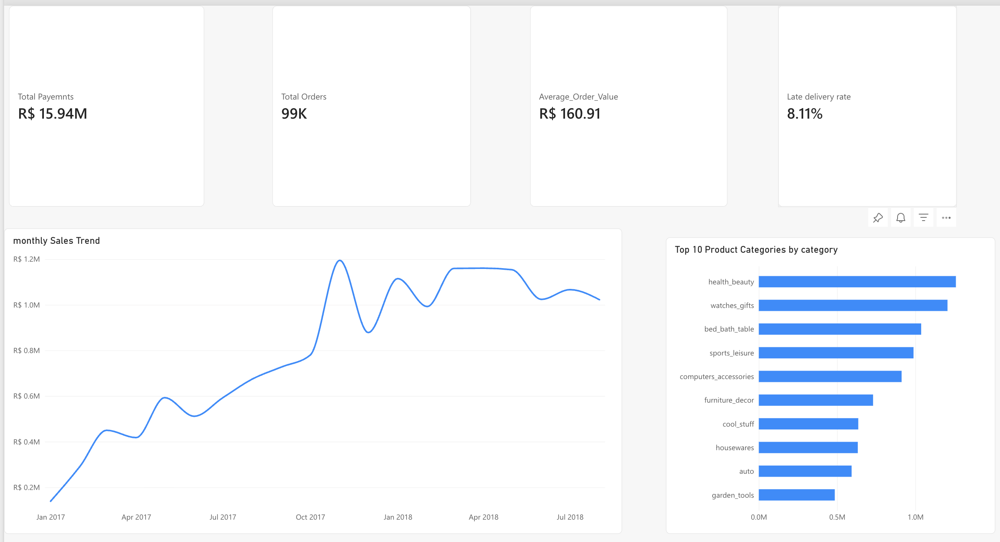
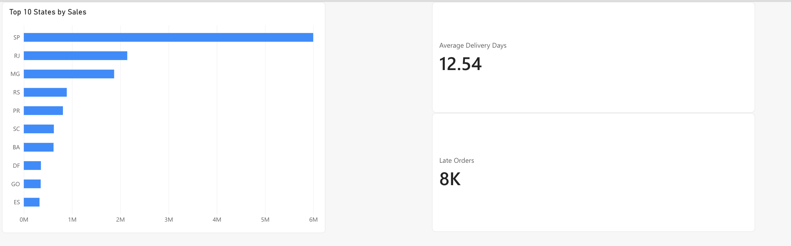

# E-Commerce Sales & Operations Analytics

An end-to-end e-commerce analytics project using MySQL, SQL, Power BI, and DAX to analyze sales performance, product categories, customer geography, and delivery efficiency.

## Project Overview

This project analyzes the Brazilian Olist E-Commerce Dataset, containing approximately 100,000 orders.

The goal is to transform transactional data into actionable business insights through SQL analysis and interactive Power BI reporting.

### Business Questions

- How do monthly payment volumes and order counts change over time?
- Which product categories generate the highest merchandise sales?
- Which Brazilian states contribute the most payment value?
- What proportion of delivered orders arrive late?
- Are there any data quality issues affecting the analysis?

## Tools & Technologies

- **MySQL:** Relational database and SQL analytics
- **DataGrip:** SQL development and database management
- **Power BI:** Interactive business reporting
- **DAX:** Calculated business measures
- **PyCharm:** Project organization and documentation

## Dataset

**Source:** Brazilian E-Commerce Public Dataset by Olist (Kaggle)

The project uses nine relational tables covering customers, orders, order items, payments, products, sellers, reviews, category translations, and geolocation data.

### Data Processing

1. Imported raw CSV data into MySQL.
2. Analyzed transactions using joins, aggregations, conditional logic, CTEs, and window functions.
3. Created four reusable SQL views.
4. Exported aggregated results as CSV files.
5. Imported the datasets into Power BI for reporting.

## SQL Analysis

Four SQL views support the dashboard:

| View | Purpose |
|------|---------|
| `vw_monthly_sales` | Monthly order counts, payment value, and AOV |
| `vw_category_sales` | Merchandise sales by product category |
| `vw_state_sales` | Customer counts, orders, and payments by state |
| `vw_delivery_performance` | Delivery volume, delays, and average delivery time |

The SQL scripts are available in the `sql/` directory.

## Power BI Dashboard

The Power BI report contains two pages.

### 1. Sales Overview

Key performance indicators:
- Total Payments: approximately R$15.94M
- Total Orders: approximately 99K
- Average Order Value: R$160.91
- Late Delivery Rate: 8.11%

Additional visuals include monthly payment trends and the top 10 product categories by merchandise sales.



### 2. Geographic & Delivery Analysis

This page includes:
- Top 10 Brazilian states by payment value
- Average delivery time: 12.54 days
- Late orders: 7,826



## Key Business Insights

### 1. Regional Concentration

São Paulo (SP) accounts for approximately R$6.0M in payment value, making it the largest regional market in the dataset. Rio de Janeiro (RJ) and Minas Gerais (MG) rank second and third.

### 2. Product Category Performance

Health & Beauty leads merchandise sales at approximately R$1.26M, followed by Watches & Gifts and Bed, Bath & Table.

Category performance reflects both sales volume and average item price.

### 3. Monthly Payment Trends

Monthly payments increased considerably during 2017, with a notable peak in November 2017.

The November spike may be related to seasonal shopping activity, although the dataset alone does not establish causation.

### 4. Delivery Performance

Among 96,470 delivered orders with the required dates available:

- 7,826 were delivered after their estimated delivery dates.
- The late delivery rate was 8.11%.
- Average purchase-to-delivery time was 12.54 days.


### 5. Data Quality

Data quality checks identified the following findings:

- No duplicate order IDs were found.
- No missing customer IDs, cities, or states were identified.
- One order did not have a matching payment record.
- Of 96,478 delivered orders, 8 were missing actual delivery timestamps.
- The remaining 96,470 delivered orders were eligible for delivery performance analysis.

Records with missing required delivery dates were excluded from delivery KPIs rather than assigned estimated values.


## Metric Definitions & Limitations

- Monthly payment KPIs cover January 2017 through August 2018.
- Geographic payment metrics use all matching records without the same date restriction.
- Category sales represent the sum of item prices, excluding freight.
- Payment values are not equivalent to net company revenue or profit.
- Delivery KPIs cover delivered orders with valid purchase, actual delivery, and estimated delivery timestamps.
- The underlying dataset is historical and does not represent current e-commerce performance.
- Some Power BI visuals are based on separately aggregated CSV tables, so cross-visual filtering is limited.

## Project Structure

```text
olist-ecommerce-analytics/
├── data/
│   ├── raw/
│   └── cleaned/
├── docs/
├── images/
│   ├── sales_overview.png
│   └── geographic_delivery.png
├── powerbi/
├── python/
├── sql/
│   ├── 01_create_database.sql
│   ├── 02_create_tables.sql
│   ├── 03_sales_analysis.sql
│   └── 04_create_views.sql
└── README.md
```

## How to Reproduce

1. Download the Brazilian Olist E-Commerce Dataset from Kaggle.
2. Create the MySQL database using `sql/01_create_database.sql`.
3. Create the required tables using `sql/02_create_tables.sql`.
4. Import the original CSV files into their corresponding MySQL tables.
5. Run `sql/03_sales_analysis.sql` for business analysis.
6. Run `sql/04_create_views.sql` to create the reporting views.
7. Export the view results to CSV.
8. Import the aggregated CSV files into Power BI and recreate the dashboard.

## Data Source

Brazilian E-Commerce Public Dataset by Olist:

https://www.kaggle.com/datasets/olistbr/brazilian-ecommerce
